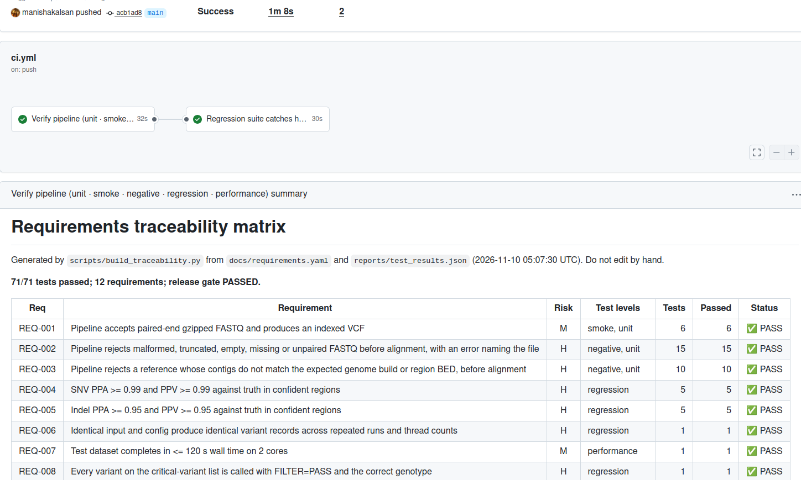

# ngs-vv-demo: a verified mini variant-calling pipeline

[](https://github.com/manishakalsan/ngs-vv-demo/actions/workflows/ci.yml)



A small germline variant-calling pipeline (FASTQ → fastp → BWA-MEM → samtools → bcftools → VCF) treated the way regulated NGS software is: numbered requirements, tests traced to each requirement, locked acceptance criteria, a regression suite that is itself tested, pinned tool versions, and a verification report.

**What it demonstrates:** turning a research pipeline into something tested, traceable and release-ready. It is a demonstration, not a validated diagnostic.

## Traceability matrix

Generated on every CI run from `docs/requirements.yaml` and the test results; the full version with each test listed is in [docs/traceability_matrix.md](docs/traceability_matrix.md).

<!-- TRACE:START -->
_71/71 tests passed · generated 2026-11-10 10:24:26 IST_

| Req | Requirement | Risk | Tests | Status |
| --- | --- | :-: | --: | --- |
| REQ-001 | Pipeline accepts paired-end gzipped FASTQ and produces an indexed VCF | M | 6 | ✅ PASS |
| REQ-002 | Pipeline rejects malformed, truncated, empty, missing or unpaired FASTQ before alignment, with an error naming the file | H | 15 | ✅ PASS |
| REQ-003 | Pipeline rejects a reference whose contigs do not match the expected genome build or region BED, before alignment | H | 10 | ✅ PASS |
| REQ-004 | SNV PPA >= 0.99 and PPV >= 0.99 against truth in confident regions | H | 5 | ✅ PASS |
| REQ-005 | Indel PPA >= 0.95 and PPV >= 0.95 against truth in confident regions | H | 5 | ✅ PASS |
| REQ-006 | Identical input and config produce identical variant records across repeated runs and thread counts | H | 1 | ✅ PASS |
| REQ-007 | Test dataset completes in <= 120 s wall time on 2 cores | M | 1 | ✅ PASS |
| REQ-008 | Every variant on the critical-variant list is called with FILTER=PASS and the correct genotype | H | 1 | ✅ PASS |
| REQ-009 | Output VCF is sorted, normalised (left-aligned, biallelic) and calls below the QUAL threshold are FILTER=LowQual | M | 11 | ✅ PASS |
| REQ-010 | Every run records the versions of all software components used | M | 1 | ✅ PASS |
| REQ-011 | The evaluation code computes TP, FP, FN, PPA and PPV correctly (validation of the test tool itself) | H | 10 | ✅ PASS |
| REQ-012 | Variants outside confident regions are excluded from accuracy metrics | M | 9 | ✅ PASS |
<!-- TRACE:END -->

## Quick start

```bash
# 1. environment (exact versions; see docs/SETUP_GUIDE.md for installing micromamba)
micromamba create -n ngs-vv-demo -f envs/conda-linux-64.lock    # or: -f envs/environment.yml
micromamba activate ngs-vv-demo

# 2. run the pipeline on the bundled synthetic data (~2 s)
snakemake --cores 2
cat results/SYNTH1/eval/metrics.tsv

# 3. run the verification suite and rebuild the traceability matrix
pytest --cov=vvdemo
python scripts/build_traceability.py

# 4. show the regression suite catching a harmful change
bash scripts/demo_regression_catch.sh
```

`make help` lists the same commands.

## Pipeline

```
FASTQ R1/R2 ─▶ validate_inputs ─▶ fastp ─▶ BWA-MEM ─▶ samtools sort/index
                (REQ-002/003)                              │
                                                           ▼
 metrics.json ◀─ evaluate vs truth ◀─ filter QUAL<20 ◀─ norm ◀─ bcftools mpileup/call
  (PPA/PPV)        (REQ-011/012)       (REQ-009)
```

| Output | Path |
| --- | --- |
| VCF + index | `results/SYNTH1/SYNTH1.vcf.gz{,.tbi}` |
| BAM + index | `results/SYNTH1/SYNTH1.bam{,.bai}` |
| QC | `results/SYNTH1/qc/` (input validation, fastp JSON/HTML) |
| Accuracy | `results/SYNTH1/eval/metrics.{json,tsv}` |
| Versions | `results/software_versions.txt` |

## Tests

| Level | What it checks | Count |
| --- | --- | --: |
| Unit | Validators, VCF parsing, comparator, boundary values | 47 |
| Smoke | Pipeline runs end to end; outputs and versions written | 3 |
| Negative | Truncated, corrupt, empty, missing or unpaired FASTQ; wrong build; wrong BED naming. Each must fail **before** alignment | 8 |
| Regression | Locked thresholds, drift vs baseline, critical variants, VCF normalisation, repeatability across 1/2/4 threads | 12 |
| Performance | Runtime within limit, recorded per run | 1 |

CI runs two jobs: the full suite, and a **regression-power** job that applies a known-harmful change ([CR-001](docs/changes/CR-001_impact.md): skip indel calling) and passes only if the suite fails on it.

## Data

- **Synthetic (bundled, used in CI):** 30 kb reference, 6,000 read pairs, 53 inserted variants with exact truth. Regenerate with `python scripts/simulate_test_data.py`.
- **GIAB HG002 chr20 (realistic benchmark):** `bash scripts/fetch_giab.sh`, then see [docs/giab_mode.md](docs/giab_mode.md).

## Documentation

| Document | Purpose |
| --- | --- |
| [Requirements](docs/requirements.md) | What the software must do, and why |
| [Test plan](docs/test_plan.md) | Scope, levels, entry/exit criteria, change control, severity |
| [Risk analysis](docs/risk_analysis.md) | Hazards, controls, residual risk |
| [SOUP list](docs/soup_list.md) | Third-party components, versions, known issues |
| [Verification report](docs/verification_report.md) | Results of v1.0.0 verification |
| [Traceability matrix](docs/traceability_matrix.md) | Requirement → test → result |
| [CR-001](docs/changes/CR-001_impact.md) | Worked change-impact assessment |

## Limitations

- Synthetic data are easy (no repeats or mapping ambiguity); perfect scores there are not a performance claim.
- The built-in comparator is not haplotype-aware; use hap.py for GIAB.
- Single sample, single contig/region; no wet-lab, multi-instrument or clinical validation.
